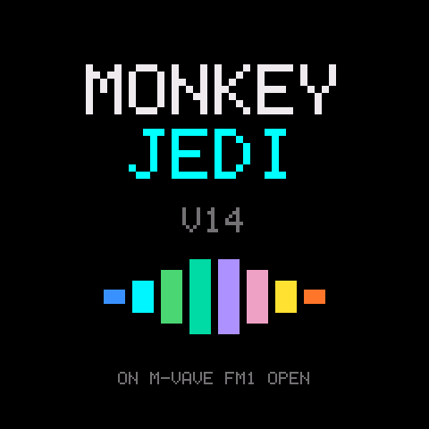

# Monkey Jedi FM-1 firmware

A custom build of M-VAVE's open FM-1 firmware (FM1 Open V14). It can be developed from a Mac: GitHub builds it on a Windows machine in the cloud.



## How it works

1. Change the code and push it to GitHub.
2. GitHub Actions builds it on Windows (**Actions** tab → **Build firmware**). This takes about 10 to 20 minutes the first time, faster after that.
3. When the run is green, open it and download the **fm1-firmware** artifact (a zip).
4. Unzip it and open `FM1-Official-Open-Source.html` in **Chrome or Edge**. Safari can't talk to USB devices.
5. Plug in the FM-1 and use the page to flash it.

## Before your first flash

- **Back up first.** Use the official [FM1 Workbench](https://open.m-vave.com/fm1-workbench) to export your projects, voices and samples.
- **Keep the FM-1 plugged in** and powered for the whole write. Don't unplug it halfway.
- **To go back to stock**, the flasher page has a "return to original V15" option. M-VAVE's Workbench can do the same.

## Changing the boot screen

The text is in `app/screen.c`. Search for `BOOT_LINE_1`:

```c
#define BOOT_LINE_1 "MONKEY"
#define BOOT_LINE_2 "JEDI"
#define BOOT_FOOTER "ON M-VAVE FM1 OPEN"
```

- The screen is 240 × 240. The big lines fit **10 characters** each.
- The font has `0-9`, `A-Z` and basic punctuation. Lowercase is shown as uppercase.
- Colors are RGB565 values such as `TEXT`, `ACCENT` and `DIM`, defined at the top of `screen.c`.

To preview it without flashing (needs Python and Pillow):

```bash
python3 tools/preview_boot.py docs/boot-preview.png
```

## Samples and sounds

You don't need a firmware change to load your own samples or DX7 voices. Use the official Workbench, which runs in the browser on any computer.

## License

GPLv3 with the FM1 SDK linking exception. See `LICENSE.md` and `THIRD_PARTY.md`. Each build's flasher page links to the exact source it was built from.
